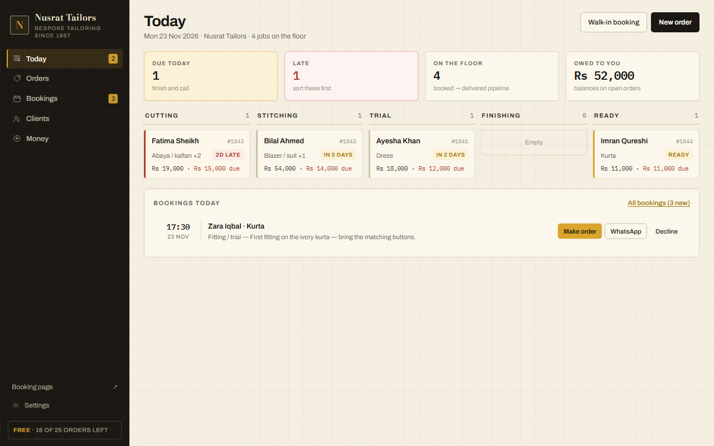

# Chalkline

**The workbench for a bespoke tailoring shop.** Bookings, client measurements, orders, money, and a pattern-paper design board where the tailor chalks the garment — in one place, offline, on any laptop in the workroom.

Live demo → **[chalkline.netlify.app](https://chalkline.netlify.app)** · Case study → **[case.html](https://chalkline.netlify.app/case.html)** · Client booking page → **[book.html](https://chalkline.netlify.app/book.html)**



---

## What it does

| | |
| --- | --- |
| **Booked** | A public booking page for the shop: opening hours, closed day, slot length, real availability. A request arrives *unanswered* until the shop confirms it. |
| **Cutting → Ready** | The board is the production line: five stage columns, plus due today, late, on the floor and owed to you. |
| **Measurements** | Per person, per garment, in inches or centimetres, with history. A new entry is a new date — nothing is overwritten. |
| **Design board** | Chalk, line, arrow, note, five colours, undo, grid. Measurement pins bind to the client's real numbers. Saves as vectors. |
| **Tickets** | A real print stylesheet: one ticket per garment on A4, with the design PNG embedded at full fidelity. |
| **Money** | Totals, deposits and a payment ledger per order. Collected, outstanding, six months of collection, and what each client still owes. |
| **Backup** | Everything is `localStorage` + a JSON file you can download and restore. No account, no server, no telemetry. |

## Run it

No build step, no dependencies.

```bash
cd chalkline
python -m http.server 4173
```

- `http://localhost:4173` — landing page
- `http://localhost:4173/app.html?demo=1` — the workbench, seeded with the demo shop *Nusrat Tailors*
- `http://localhost:4173/book.html` — the client-facing booking page

The workbench and the booking page share `localStorage`, so a booking made on the client page appears in the shop's Bookings tab in the same browser.

## Tests

```bash
node --test domain.test.mjs canvas.test.mjs
```

30 cases over the domain (money and balances, stage transitions, booking validation and slot collisions, unit conversion, measurement history) and the canvas geometry (distance-to-segment hit testing, path simplification, bounds, fixed-space coordinates).

## Layout

```
index.html      landing page
case.html       case study
app.html        the workbench (hash-routed single page)
book.html       the public booking page
domain.js       pure domain: state shape, money, dates, bookings, measurements
canvas.js       the design board: rendering, vector strokes, pins, PNG export
app.js          workbench UI, routing, dialogs, printing
booking.js      booking page UI
styles.css      workbench styles (incl. print stylesheet)
landing.css     marketing + case study styles
```

## Design notes

- **Paper as an instrument.** Cream ground, hairline rules, tabular figures, Bodoni Moda for display, Archivo for body, IBM Plex Mono for numbers. One chalk accent (`#d9a52f`) means *act*; red (`#b23a2c`) only ever means late or owed.
- **A booking is a question until the shop answers it.** `new → confirmed → converted`, or `declined`. Confirming and writing the order are deliberately two steps, because a shop says "come at 4" before it knows the price.
- **The board stores vectors** in a fixed 1000 × 1400 space, so screen, export and print are the same drawing at three sizes.

## Business model

One shop, one price — not per seat.

| Plan | Price | |
| --- | --- | --- |
| Free | $0 | 25 orders, forever. Board, tickets, booking page, backups all included. |
| Shop | $12 / month | Unlimited orders and clients, every device in the workroom. |
| Shop, yearly | $99 / year | Two months free. |

The limit is enforced where work starts: the 26th order opens the upgrade sheet and says why.

The upgrade currently ends at a demo checkout that flips a local flag. Production would mint a signed key (ECDSA P-256) and verify it in the browser, so a paid shop needs no login and no licence server — which is the whole reason there is no account anywhere in this app.

## Status

Working demo, not yet sold to a shop. Known gaps, honestly: the booking link needs hosting; two laptops mean two books until sync exists; the upgrade flow ends at a placeholder checkout. The case study covers why each of those is deferred rather than hidden.
